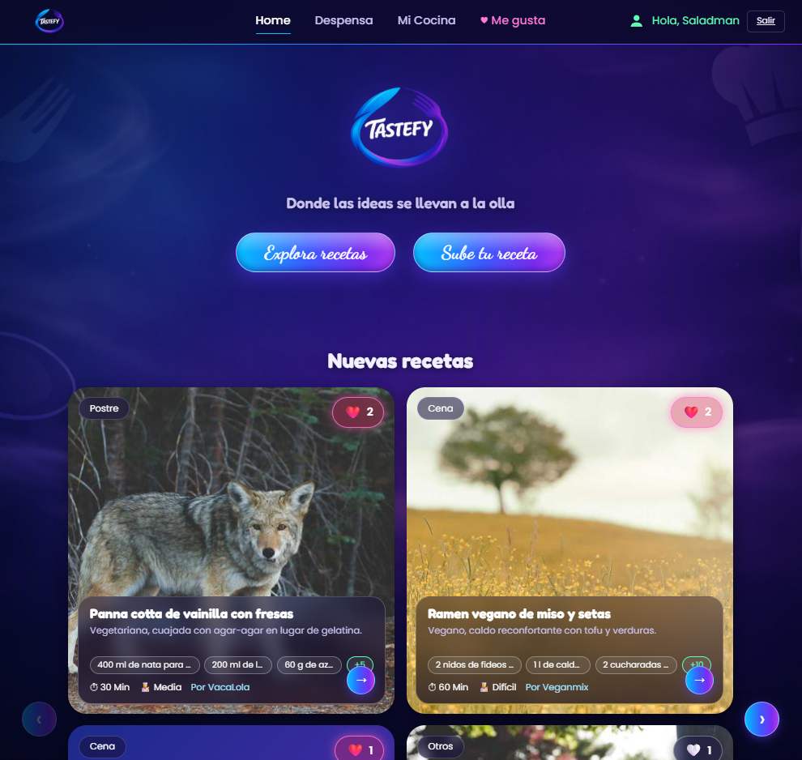
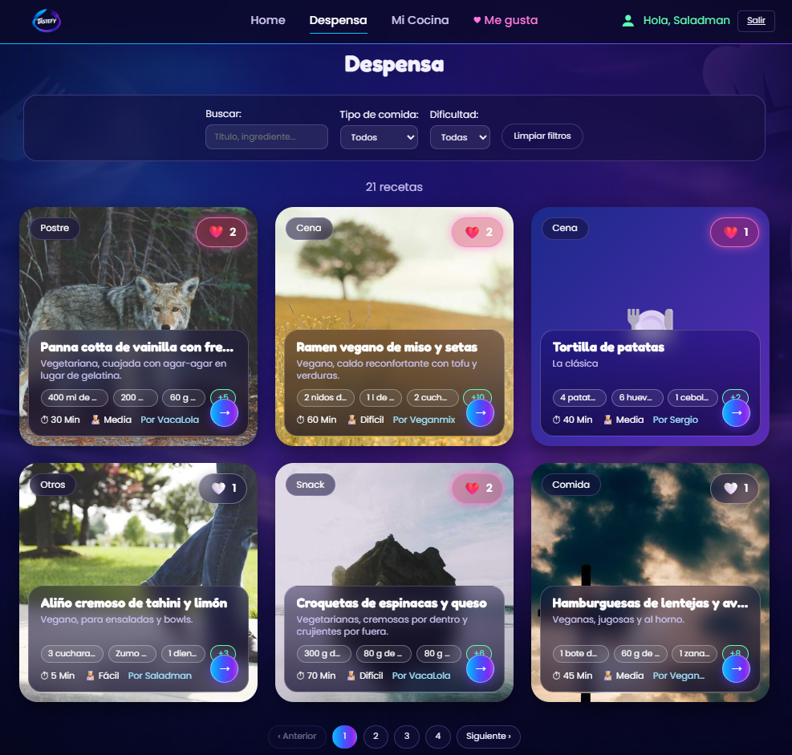
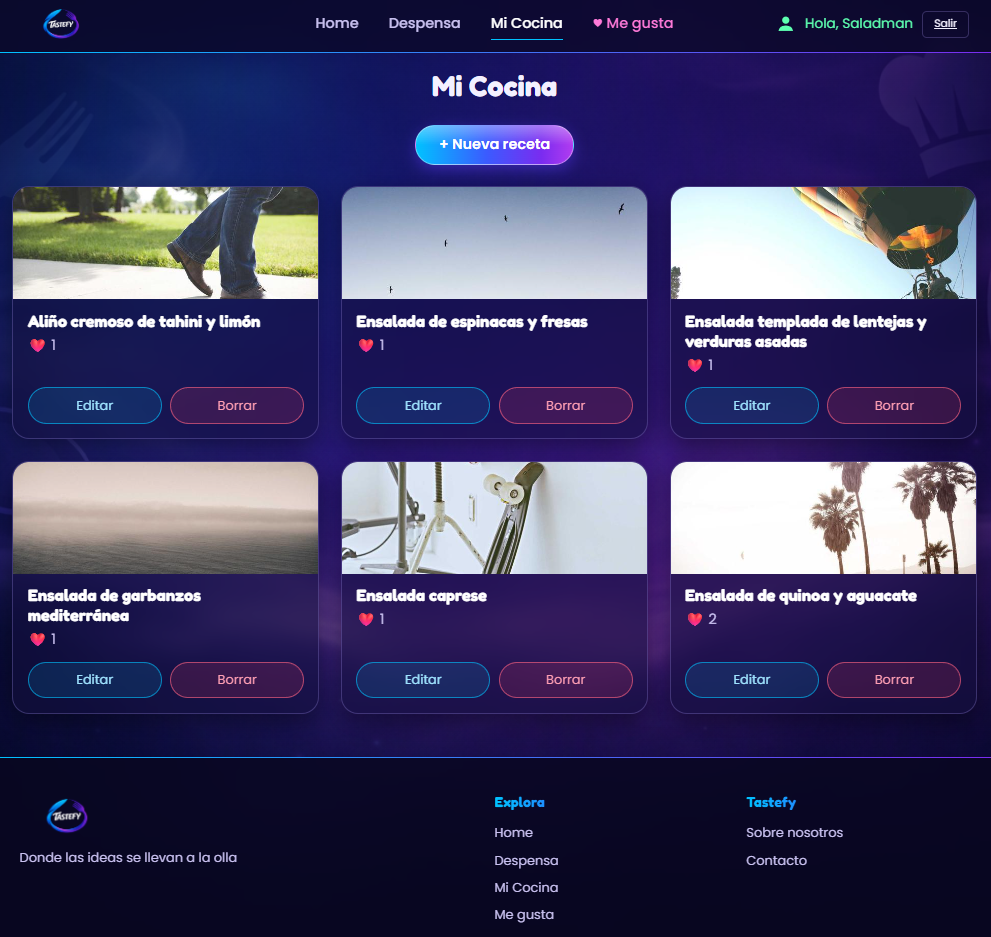

<p align="center">
  
</p>

<h1 align="center">TASTEFY</h1>
<p align="center"><i>Donde las ideas se llevan a la olla</i></p>

<p align="center">
  <a href="https://tastefy-peach.vercel.app">
    
  </a>
</p>

> ⏳ La API está en el plan gratuito de Render: si lleva un rato sin visitas, la primera carga puede tardar 30-50 segundos.

<p align="center">
  
  
  
  
  
  
  
</p>

## Sobre el proyecto

**Tastefy** es una red social de recetas full-stack: los usuarios publican sus platos,
descubren los de otras personas, los filtran por tipo de comida o dificultad y guardan
sus favoritos con un "me gusta".

Lo he creado para practicar desarrollo full-stack de principio a fin: API REST con
autenticación, base de datos en la nube, subida de imágenes, tests automáticos, despliegue
en producción y una interfaz propia con diseño a medida.

## Capturas

| Home | Despensa | Mi Cocina |
|---|---|---|
|  |  |  |

## Funcionalidades

- **Registro e inicio de sesión** con JWT y contraseñas cifradas.
- **Home** con carruseles de "Nuevas recetas" y "Los más gustados".
- **Despensa**: búsqueda por texto (título, descripción e ingredientes), filtros por tipo
  de comida y dificultad, orden por fecha o por likes, y paginación.
- **Mi Cocina**: crear, editar y borrar tus propias recetas, con confirmación antes de borrar.
- **Subida de fotos** desde la galería del usuario: la API las recibe con Multer y las
  guarda en Cloudinary.
- **Me gusta** sincronizados por usuario, y página con todas las recetas que te gustan.
- **Rutas protegidas** para las secciones privadas.
- **Diseño propio** en tema oscuro con efecto cristal, fuentes personalizadas, componentes
  reutilizables y adaptado a móvil.

## Tecnologías

| Parte | Tecnologías |
|---|---|
| Front end | React, Vite, React Router, CSS propio (variables, glassmorphism, grid) |
| Back end | Node.js, Express 5, Mongoose 9, JWT, bcryptjs, CORS, Multer |
| Base de datos | MongoDB Atlas |
| Imágenes | Cloudinary |
| Tests | Mocha, Chai, Supertest |

## 🌐 Despliegue

| Parte | Plataforma |
|---|---|
| Front end (React + Vite) | Vercel |
| API (Node + Express) | Render |
| Base de datos | MongoDB Atlas |
| Imágenes | Cloudinary |

## Estructura

```
Tastefy/
├── client/     # Front end (React + Vite)   → ver client/README.md
├── server/     # API REST (Express)         → ver server/README.md
└── docs/       # Capturas e imágenes del README
```

## Puesta en marcha

Necesitas **Node.js 18+**, una base de datos en **MongoDB Atlas** y una cuenta gratuita
de **Cloudinary**.

```bash
git clone https://github.com/SergioPerez3/Tastefy.git
cd Tastefy
```

**1. Back end**

```bash
cd server
npm install
```

Crea `server/.env`:

```
PORT=4000
MONGO_URI=tu_cadena_de_conexion_de_atlas
JWT_SECRET=una_clave_larga_y_secreta
CLOUDINARY_CLOUD_NAME=tu_cloud_name
CLOUDINARY_API_KEY=tu_api_key
CLOUDINARY_API_SECRET=tu_api_secret
```

```bash
npm run seed    # datos de ejemplo (opcional)
npm run dev     # API en http://localhost:4000
```

**2. Front end** (en otra terminal)

```bash
cd client
npm install
```

Crea `client/.env`:

```
VITE_API_URL=http://localhost:4000
```

```bash
npm run dev     # web en http://localhost:5173
```

## Cuentas de ejemplo

Tras ejecutar `npm run seed` hay tres usuarios, todos con contraseña `123456`:

| Usuario | Correo |
|---|---|
| Saladman | saladman@recipehub.dev |
| Veganmix | veganmix@recipehub.dev |
| VacaLola | vacalola@recipehub.dev |

## API

| Método | Ruta | Descripción | Auth |
|---|---|---|---|
| POST | `/auth/register` | Crear cuenta | No |
| POST | `/auth/login` | Iniciar sesión | No |
| GET | `/recipes` | Listar recetas | No |
| GET | `/recipes/:id` | Detalle de receta | No |
| POST | `/recipes` | Crear receta | Sí |
| PUT | `/recipes/:id` | Editar receta (solo su autor) | Sí |
| DELETE | `/recipes/:id` | Borrar receta (solo su autor) | Sí |
| GET | `/recipes/liked` | Recetas que me gustan | Sí |
| POST | `/recipes/:id/likes` | Dar me gusta | Sí |
| DELETE | `/recipes/:id/likes` | Quitar me gusta | Sí |
| GET | `/users/:id` | Perfil público y sus recetas | No |
| POST | `/upload` | Subir una foto (campo `image`, máx. 5 MB) | Sí |

La documentación detallada está en [`server/README.md`](server/README.md).

## Tests

Los tests usan una base de datos aparte y se niegan a ejecutarse si la conexión no
contiene `test`, para no tocar nunca los datos reales.

```bash
cd server
npm test
```

## Próximos pasos

- [x] Subida de fotos desde la galería
- [x] Diseño responsive para móvil
- [x] Despliegue (Vercel + Render)

## Autor

**Sergio Pérez Pérez** · Desarrollador full-stack junior · Madrid

[](https://github.com/SergioPerez3)

---

<p align="center">© 2026 Tastefy. Todos los derechos reservados.</p>